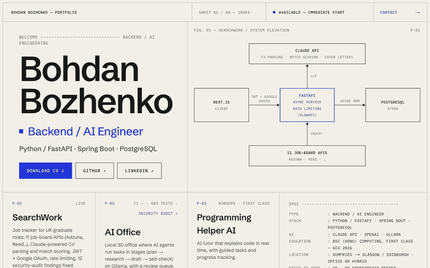
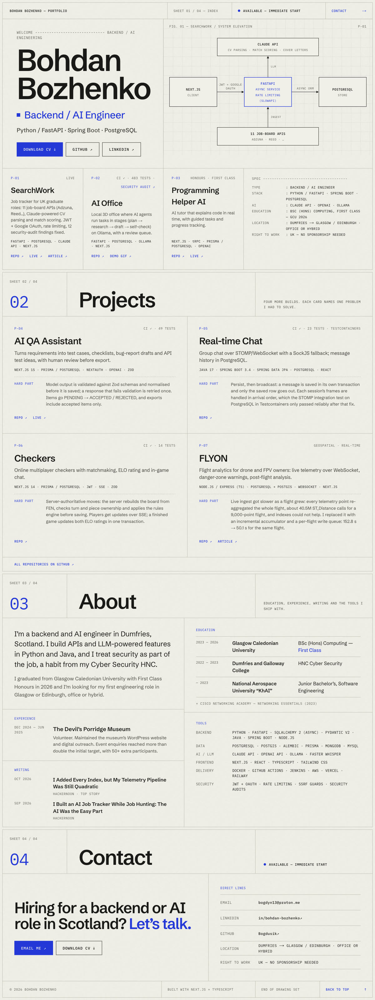
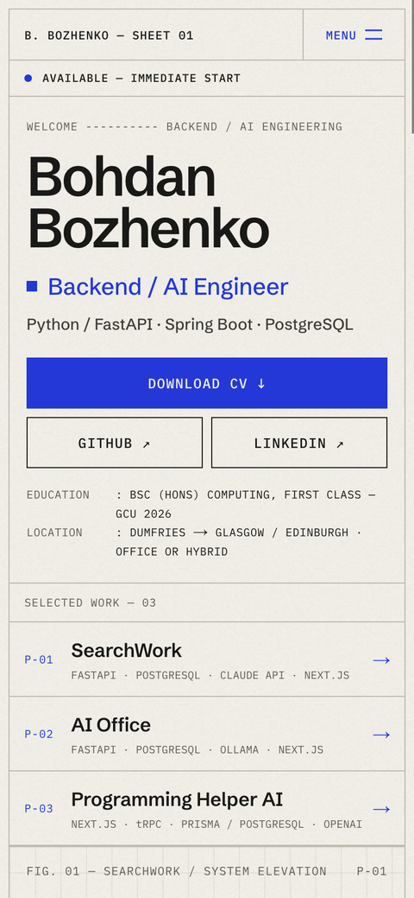

<div align="center">



# Bohdan Bozhenko — portfolio

**A one-page portfolio in the style of an engineering drawing set: four sheets, one accent colour, mono labels. No loaders, no 3D, no tracking.**

[](https://github.com/Bogdusik/Personal-Web-Site/actions/workflows/ci.yml)


[Live site](https://personal-website-bogdusik.vercel.app) · [Design](#design) · [Run it](#run-it) · [Checks](#checks)

</div>

## Design

The page reads as four numbered sheets: **Index**, **Projects**, **About** and **Contact**. The index sheet opens with a system-elevation drawing of SearchWork, and each project card names one hard problem and how it was solved.



It works on narrow screens too, with no horizontal scroll, and the main links keep a 44 px touch target.



- **Static.** Every route is prerendered by Next.js and served as static content from Vercel. There is no API, database or analytics.
- **One source for copy.** All text lives in typed files under `frontend/src/content/`, and the components only render it.
- **Numbers have sources.** Every figure on the page (tests, findings, timings) points to a file, a commit or a green CI run, listed in section 9 of [the design spec](docs/superpowers/specs/2026-10-15-blueprint-redesign-design.md). A test count appears only for tests that CI actually runs.
- **SEO and sharing.** Generated Open Graph image, sitemap, `robots.txt` and JSON-LD.

## Stack

Next.js 16 (App Router, prerendered), React 19, TypeScript 6, Tailwind CSS 4, Vitest and Testing Library, deployed on Vercel. The app lives in `frontend/`.

```
Personal-Web-Site/
├── frontend/
│   ├── src/app/          # Layout, page, metadata, OG image, sitemap, robots
│   ├── src/components/   # Header, diagram, project cards, sheets, UI primitives
│   ├── src/content/      # All copy and links as typed data
│   ├── tests/unit/       # Component and content tests
│   ├── tests/smoke/      # Deployment and external link checks
│   └── public/           # CV, favicon, grain texture
├── docs/                 # Design spec and plan
└── .github/workflows/    # CI and a weekly production link check
```

## Run it

Needs Node.js 24.

```bash
cd frontend
npm ci
npm run dev        # http://localhost:3000
```

## Checks

```bash
npm run lint
npm run typecheck
npm test           # 53 unit tests
npm run build
```

CI runs all four on every push and pull request.

A second workflow runs every Monday against the live site:

```bash
SMOKE_URL=https://personal-website-bogdusik.vercel.app npm run test:smoke
```

It checks the home page, the CV, the redirect from the old CV URL, and that every external link on the site opens and is public. For a protected preview deployment, also set `VERCEL_BYPASS` to a Vercel protection-bypass secret.

## What I learned

- **Content as data:** keeping copy in typed files made it possible to test it, for example that every external link is reachable and every project card has the fields it needs.
- **Claims need evidence:** the site makes factual claims about my work, so each one is tied to a source and the weekly check catches links that go stale.
- **Design with constraints:** one accent colour and two typefaces, Schibsted Grotesk and IBM Plex Mono, keep the drawing-set look consistent.
